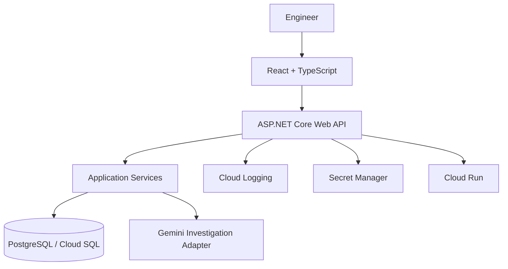

# RootBeacon (working name)

*Find the cause. Plan the fix.*

**AI-powered incident intelligence for engineering teams.**

RootBeacon helps small engineering teams investigate production incidents by analyzing application logs, identifying evidence-backed root-cause hypotheses, and generating actionable troubleshooting recommendations.

> Project status: Working demo. The API runs zero-config with a seeded SQLite demo database, and the React dashboard shows evidence-linked, clearly labeled **simulated** analysis (deterministic, local, no external AI). The Gemini adapter, authentication, multi-tenancy, migrations, tests and production deployment are still open before real customer use.

## Product goals

- Reduce manual effort during incident investigation.
- Turn raw application logs into structured, explainable findings.
- Link every AI-generated hypothesis to actual log evidence.
- Preserve incident history and investigation results.
- Keep humans in control of remediation decisions.

## MVP scope

1. Create and manage incidents.
2. Add incident logs.
3. Analyze incidents through a dedicated AI service boundary.
4. Store structured analyses and evidence.
5. Review incident history and dashboard summaries.

The initial scaffold includes a .NET API, React/TypeScript frontend, PostgreSQL configuration, Docker Compose, API health endpoint, and CI workflow. AI analysis is an integration point until Gemini credentials and the implementation are configured.

## Architecture



## Repository structure

```text
opspulse-ai/
├── backend/
│   └── OpsPulse.Api/
│       ├── Controllers/
│       ├── Data/
│       ├── DTOs/
│       ├── Models/
│       ├── Services/
│       ├── Properties/
│       ├── Program.cs
│       ├── appsettings.json
│       └── OpsPulse.Api.csproj
├── frontend/
│   └── opspulse-web/
│       ├── src/
│       ├── index.html
│       ├── package.json
│       └── vite.config.ts
├── docs/
│   ├── ARCHITECTURE.md
│   ├── API.md
│   ├── ROADMAP.md
│   └── SECURITY.md
├── .github/workflows/ci.yml
├── .env.example
├── .gitignore
├── docker-compose.yml
├── Dockerfile
└── README.md
```

## Technology stack

| Layer | Technology |
|---|---|
| Frontend | React, TypeScript, Vite |
| Backend | C#, ASP.NET Core Web API, .NET 10 |
| Data access | Entity Framework Core |
| Database | PostgreSQL |
| AI | Google Gemini API (adapter to be configured) |
| Cloud | Google Cloud Run, Cloud SQL, Secret Manager |
| CI | GitHub Actions |
| Local containers | Docker |

## Prerequisites

- .NET 10 SDK
- Node.js 22 or a currently supported LTS release
- npm
- Docker Desktop (recommended)
- Git

## Run the demo (zero config)

No database, Docker or API keys needed. The demo uses a local SQLite file and seeds four synthetic incidents on first run.

```bash
# Terminal 1: API on http://localhost:5000
cd backend/OpsPulse.Api
dotnet run

# Terminal 2: dashboard on http://localhost:5173
cd frontend/opspulse-web
npm install
npm run dev
```

Open http://localhost:5173, select an incident and choose **Run simulated analysis**. Without the API running, the dashboard falls back to a fully in-browser demo mode; both modes are labeled SIMULATED and use synthetic data only. Analysis never executes commands, SQL or remediation; it suggests steps for a human operator.

To use PostgreSQL instead of the SQLite demo database, set `ConnectionStrings__DefaultConnection` and see the full setup below.

## Run locally with PostgreSQL

### 1. Clone the repository

```bash
git clone https://github.com/<YOUR_GITHUB_USERNAME>/opspulse-ai.git
cd opspulse-ai
```

### 2. Start PostgreSQL

```bash
docker compose up -d postgres
```

Default local database settings are for development only. Change them before sharing or deploying the application.

### 3. Create the database schema (first run)

Install the EF Core CLI tool if it is not already available:

```bash
dotnet tool install --global dotnet-ef
```

Then create and apply the initial migration:

```bash
cd backend/OpsPulse.Api
dotnet restore
dotnet ef migrations add InitialCreate
dotnet ef database update
```

Commit the generated `Migrations/` folder so other developers and deployment environments can reproduce the schema.

### 4. Run the backend

```bash
dotnet run
```

The API uses `ConnectionStrings__DefaultConnection` when supplied. Without it, it starts in the zero-config SQLite demo mode described above.

Swagger is enabled in Development. Check the console for the actual local URL.

### 5. Run the frontend

In a second terminal:

```bash
cd frontend/opspulse-web
npm install
cp .env.example .env
npm run dev
```

On Windows PowerShell, use:

```powershell
Copy-Item .env.example .env
```

Set `VITE_API_BASE_URL` to the backend URL printed by `dotnet run`, including `/api` only if your API routes require it. The default is `http://localhost:5000`; update it to match your actual local API URL.

### 6. Build checks

```bash
cd backend/OpsPulse.Api
dotnet build
```

```bash
cd frontend/opspulse-web
npm ci
npm run build
```

## Configuration

See `.env.example`. Never commit real API keys, passwords, service-account files, or production connection strings.

For ASP.NET Core, environment variables use double underscores, for example:

```text
ConnectionStrings__DefaultConnection
Gemini__ApiKey
Gemini__Model
```

The Gemini service is deliberately isolated behind an interface. Configure and implement the provider before enabling AI analysis in a deployed environment.

## API

Initial endpoints:

| Method | Endpoint | Purpose |
|---|---|---|
| GET | `/api/health` | Health check |
| GET | `/api/incidents` | List incidents |
| GET | `/api/incidents/{id}` | Get incident |
| POST | `/api/incidents` | Create incident |
| POST | `/api/incidents/{id}/logs` | Add log entries |
| POST | `/api/incidents/{id}/analyze` | Run analysis (simulated engine by default; Gemini adapter still to be implemented) |
| PATCH | `/api/incidents/{id}/status` | Update status |

See [docs/API.md](docs/API.md) for request examples and current implementation notes.

## Product principles

- AI findings are hypotheses, not verified facts.
- Every root-cause hypothesis should cite evidence from supplied logs.
- Never fabricate log evidence.
- Never execute AI-generated shell commands, SQL, or infrastructure changes.
- Human approval is required before remediation.
- Uploaded logs are untrusted input and may contain secrets or personal data.

## Roadmap

See [docs/ROADMAP.md](docs/ROADMAP.md).

## Contributing

See [CONTRIBUTING.md](CONTRIBUTING.md) for local checks and contribution guidelines.

## License

No license has been assigned yet. All rights reserved by default until the project owner adds an explicit license.
